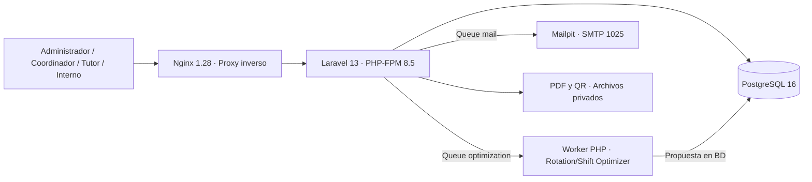
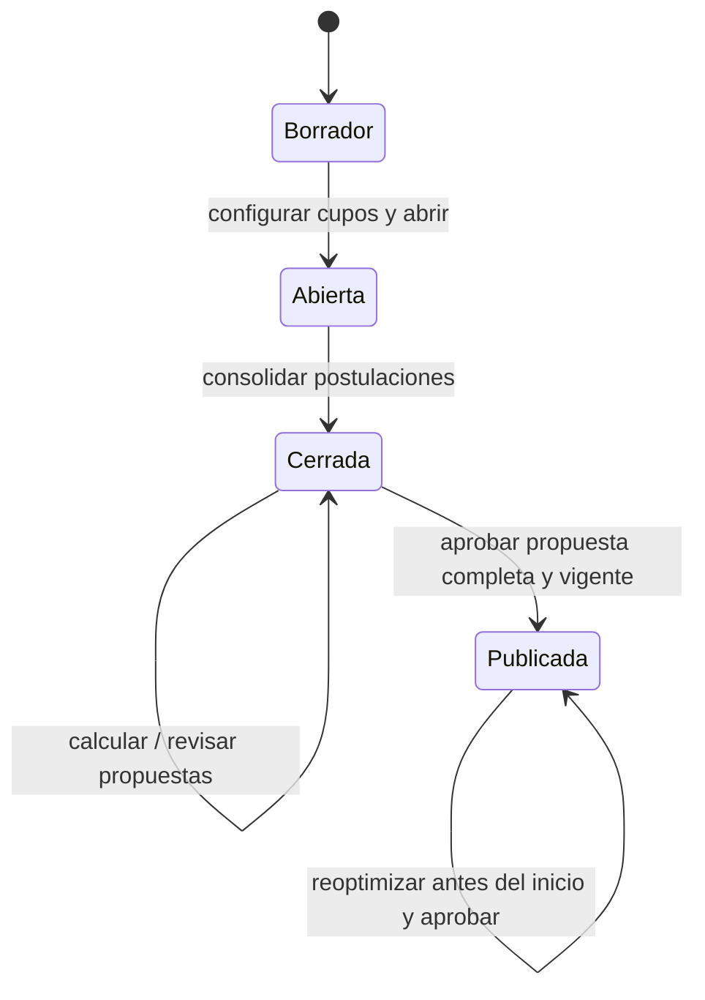

# Alcance y correspondencia con el informe

## Fuentes y decisiones de alcance

Se revisó `INFORME_ADIHnw.docx` y la ampliación a siete módulos aportada en la conversación. El ámbito del portal es **Medicina de Unifranz, sede La Paz**. El texto adjunto se trató como contexto de requisitos, no como instrucciones para ejecutar acciones externas.

El informe original describe cinco grupos funcionales y menciona A3, escenarios E1–E3, Timefold, seguimiento y actas. La ampliación distingue análisis de escenarios (módulo 6) de ejecución de asignaciones (módulo 3), y programación de guardias (módulo 7) de su seguimiento (módulo 4).

## Implementación

| Módulo | Funciones implementadas | Puntos de validación institucional |
|---|---|---|
| 1. Sesiones, usuarios y seguridad | Autenticación, cuatro roles, habilitación de cuentas, bloqueo por intentos, recuperación, cierre de sesión, bitácora y notificaciones | Correos reales, política de cuentas, despliegue HTTPS y respaldo |
| 2. Gestión hospitalaria y académica | Hospitales/convenios, especialidades, convocatorias, cupos/reservas, tutores, promedio y méritos, importación CSV atómica | Convenios reales, rúbrica de méritos, fuentes académicas, capacidad autorizada |
| 3. Postulación y optimización | Preferencias ordenadas, ventana temporal, comprobante QR privado, motor PHP (`RotationOptimizer`), propuestas, validación de versión y aprobación transaccional | Secuencia curricular anual, requisitos específicos por plaza, regla final de prioridad |
| 4. Ajustes y seguimiento | Incidencias/resolución, asistencia, rúbrica de cuatro competencias, reasignación previa al inicio, permutas con doble consentimiento y reoptimización | Rúbrica oficial, ausencias justificadas, cambios durante un rote ya iniciado |
| 5. Libreta, actas y reportes | Libreta individual, asistencia/notas, ocupación, actas PDF, historial y verificación QR/SHA-256 | Membrete/formato oficial, firma digital institucional, integración SEDES |
| 6. Escenarios | Matriz manual, cinco criterios, empates, sensibilidad de α, simulación de nueve combinaciones, política justificada | Escenarios calibrados, función de utilidad aprobada y datos observados |
| 7. Guardias y tutores | Disponibilidad, motor PHP (`ShiftOptimizer`), cobertura/carga, cruces y descansos, aprobación y cumplimiento | Descanso oficial, límites semanales, ratios de supervisión y especialidades habilitadas por tutor |

No se almacena información de pacientes. Los roles operativos implementados son administrador, coordinador, tutor e interno. La autoridad SEDES, paciente y dirección de carrera aparecen de forma inconsistente en el informe; no se añadieron accesos institucionales sin una definición de permisos y procesos. Coordinación dispone de reportes para la demostración.

## Arquitectura

- Laravel es responsable de permisos, datos, estado, formularios, validaciones, publicación y documentos.
- El worker de optimización procesa cálculos en segundo plano (`OptimizeRotations`, `ComputeShifts`, `ComputeScenario`) sin bloquear la interfaz web.
- PostgreSQL conserva el historial, las relaciones, las colas y las sesiones.
- Los siete módulos se ejecutan en un backend unificado y cohesionado.

## Entidades

| Grupo | Tablas principales |
|---|---|
| Seguridad | `users`, `sessions`, `otp_challenges`, `otp_limits`, `audit_logs`, `notifications` |
| Académico/hospitalario | `hospitals`, `specialties`, `cycles`, `places` |
| Postulación/asignación | `applications`, `optimization_runs`, `assignments` |
| Seguimiento | `clinical_records`, `incidents`, `swap_requests` |
| Decisiones | `scenario_studies` |
| Guardias | `availabilities`, `shift_batches`, `shifts` |
| Documentos | `reports` y archivos en almacenamiento privado Laravel |

## Servicios de cálculo

El backend Laravel ejecuta `RotationOptimizer`, `ShiftOptimizer` y `DecisionAnalysis` dentro de PHP. Las peticiones del portal encolan jobs y los workers guardan resultados en PostgreSQL. No existe un servicio Quarkus activo ni se publica el puerto 8081. Consulta [CONTRATO_API.md](CONTRATO_API.md) para las rutas HTTP actuales.

## Estados principales

Reoptimización, reasignación y permuta no reescriben rotes iniciados ni con seguimiento/guardias. Para cambios durante el periodo se necesita modelar segmentos y vigencias; el sistema actual conserva esos historiales y registra incidencias para revisión.

## Ajustes recomendados al informe

1. Completar el apartado de Investigación Operativa con el modelo y las pruebas de `INVESTIGACION_OPERATIVA.md`.
2. Reformular RF-10/HU-08: usar la política elegida en el módulo 6, en vez de imponer A3 de antemano.
3. Incorporar las historias de escenarios y guardias a backlog, sprints, casos de uso y diagramas.
4. Corregir las referencias cruzadas de casos de uso: el documento reutiliza UC 010 para seguimiento/reportes y algunas leyendas de figuras describen otra función.
5. Reconciliar los totales de puntos del backlog: aparecen 96 y 91 en secciones distintas.
6. Precisar que QR verifica un documento y no es firma digital de la autoridad SEDES.
7. Sustituir afirmaciones de predicción de abandono/rendimiento por seguimiento descriptivo mientras no existan datos, metodología y validación apropiados.
8. Distinguir restricciones académicas confirmadas de parámetros demostrativos: promedio/mérito 70/30, descansos de 12 horas y rúbrica con cuatro pesos iguales.
9. Distinguir satisfacción y cobertura de “equidad”: no se certifica una definición institucional de equidad sin acordar esa política.

## Límites prácticos

La implementación ofrece flujos funcionales de los siete módulos para una demostración académica. No certifica disponibilidad del 99 %, acreditación SEDES, firma digital oficial, formatos institucionales ni optimalidad global. Las pruebas cubren un problema de 180 internos y 45 grupos de capacidad, pero no sustituyen una prueba de carga multiusuario ni validación con datos reales.

La planificación de rotes se realiza por convocatoria/especialidad/periodo, comprobando cruces contra asignaciones vigentes. No calcula simultáneamente la secuencia curricular anual completa ni verifica automáticamente que cada interno termine todas las especialidades obligatorias. Las especialidades están configuradas y sus rotes quedan visibles en la libreta.

La planificación de guardias asigna supervisores a horas e internos ya definidos. No elige automáticamente las fechas, no modela supervisión simultánea de varios internos por tutor y no impone un máximo semanal institucional aún no proporcionado.

La recuperación y publicación generan correos capturados por Mailpit en el entorno local. El envío real exige configurar SMTP. Las notificaciones de publicación se intentan después de confirmar la transacción: una falla de correo no revierte asignaciones ya publicadas y se registra en logs.

## Referencias técnicas

- [Autenticación de Laravel](https://laravel.com/framework/docs/13.x/authentication).
- [Recuperación de contraseñas](https://laravel.com/framework/docs/passwords).
- [Pruebas HTTP](https://laravel.com/framework/docs/http-tests).
- [Mailpit en Docker](https://mailpit.axllent.org/docs/install/docker/).

## Evidencia de validación

Consulta [PRUEBAS.md](PRUEBAS.md) para los resultados de la revisión actual y [GUIA_DEMOS.md](GUIA_DEMOS.md) para reproducir los recorridos por rol. Los requisitos institucionales aún pendientes se detallan en [ESTADO_IMPLEMENTACION.md](ESTADO_IMPLEMENTACION.md).
