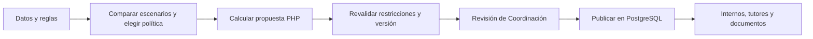

# Cómo explicar Investigación Operativa en SICLIN

## Guion de apertura (40 segundos)

> SICLIN aplica Investigación Operativa para distribuir recursos limitados: cupos de hospitales y tiempo de supervisión. Primero transforma las reglas académicas en restricciones. Después calcula propuestas que buscan cubrir a los internos y mejorar preferencias y equilibrio. Coordinación compara escenarios, elige una política y revisa el resultado antes de publicarlo. Los algoritmos están implementados en PHP y se ejecutan en segundo plano con Laravel.

No lo presentes como aprendizaje automático ni como una predicción clínica. El sistema combina **optimización combinatoria** y **análisis de decisiones bajo incertidumbre**.

## Los tres lugares donde se implementó

| Módulo | Decisión | Implementación real |
|---|---|---|
| M3 · Rotes | Qué plaza recibe cada interno | `portal/app/Services/RotationOptimizer.php`: flujo de costo mínimo con máxima cobertura |
| M6 · Escenarios | Qué política conviene según capacidad y criterio | `DecisionAnalysis.php` aplica cinco criterios; `ScenarioService.php` ejecuta 9 optimizaciones y forma la matriz |
| M7 · Guardias | Qué tutor supervisa cada turno solicitado | `ShiftOptimizer.php`: búsqueda con poda, límite de tiempo/nodos y equilibrio de carga |

Los datos proceden de PostgreSQL: habilitación, preferencias, cupos, reservas, tutores, convenios, disponibilidad y asignaciones anteriores. Las clases `RotationService` y `ShiftPlanner` preparan y validan las entradas/salidas. Los jobs `OptimizeRotations`, `ComputeScenario` y `ComputeShifts` ejecutan los cálculos en la cola `optimization`.

## Explicar el modelo de rotes (2 minutos)

La variable conceptual es **x(i,p)**: vale 1 si el interno i recibe la plaza p y 0 si no. Una plaza representa hospital, especialidad y periodo de esa convocatoria. El problema se resuelve por bloque; no se calcula simultáneamente todo el año.

**Restricciones obligatorias:**

- Cada interno recibe como máximo una plaza de esa convocatoria.
- Solo participan internos habilitados y compatibles con el periodo y sus requisitos configurados.
- La ocupación no supera `capacidad − reserva`.
- La suma de asignados a un tutor no supera su límite disponible.
- Los rotes publicados no pueden cruzarse; hospital, convenio y tutor deben estar habilitados.

**Objetivo en dos niveles:** primero cubrir al mayor número de internos; entre las soluciones con esa cobertura, mejorar la puntuación de preferencias/mérito y penalizar desequilibrio y cambios. Una puntuación alta nunca autoriza superar un cupo.

> El algoritmo construye una red: origen → interno → plaza → tutor → destino. Cada interno aporta una unidad de flujo. Las capacidades de las conexiones limitan cupos y supervisión; los costos representan la política. Se buscan caminos de menor costo en la red residual, que permite corregir decisiones previas.

Los pesos cambian según A1, A2 y A3; las restricciones obligatorias siguen vigentes en las tres. **A3 no inventa una reserva:** todas las políticas respetan la reserva configurada por Coordinación.

### Ejemplo que puedes explicar a mano

Dos internos, Ana y Bruno, prefieren A y luego B. Hay un cupo en cada hospital. Méritos 90 y 20; política A1: preferencia 10, mérito 8, equilibrio 0. Sin asignación anterior.

La satisfacción es 100 para la primera preferencia y 50 para la segunda. Beneficio por asignación: `10 × satisfacción + floor(8 × satisfacción × mérito / 100)`.

| Interno | A: primera opción | B: segunda opción |
|---|---:|---:|
| Ana, mérito 90 | 1720 | 860 |
| Bruno, mérito 20 | 1160 | 580 |

- Ana→A y Bruno→B: 1720 + 580 = **2300**.
- Ana→B y Bruno→A: 860 + 1160 = **2020**.

Ambas opciones cubren a dos personas y respetan cupos. A1 prefiere la primera por su mayor beneficio. Asignar a ambos a A queda prohibido por capacidad, aunque ambos lo prefieran. El test `test_merit_changes_first_choice_when_all_interns_receive_a_place` comprueba que intercambiar los méritos cambia quién recibe la primera opción.

En el proyecto, el mérito combinado se obtiene como `round(0.7 × promedio académico + 0.3 × méritos registrados)`. Esa ponderación es demostrativa y requiere aprobación académica.

## Explicar escenarios (2 minutos)

Hay dos fuentes que debes distinguir:

1. **Estudio manual:** una matriz ingresada para enseñar o documentar estimaciones. El ejemplo precargado está rotulado como hipotético.
2. **Simulación calculada:** se toman los postulantes y cupos de una convocatoria y se ejecutan tres políticas con tres escenarios: capacidad al 100 %, 75 % y 50 % por defecto. Son **9 ejecuciones reales del motor PHP**, con parámetros editables.

El módulo usa una utilidad común para comparar: `100 × cobertura + 25 × primeras preferencias / habilitados − 10 × diferencia de ocupación relativa`. No compara directamente los scores internos de políticas con pesos diferentes.

Ejemplo manual que encontrarás en pantalla:

| Política | E1 | E2 | E3 | Maximin | Maximax | Laplace | Hurwicz α=0.5 | Savage |
|---|---:|---:|---:|---:|---:|---:|---:|---:|
| A1 | 90 | 60 | 20 | 20 | **90** | 56.67 | 55 | 40 |
| A2 | 75 | 65 | 40 | 40 | 75 | 60 | 57.5 | 20 |
| A3 | 80 | 70 | 60 | **60** | 80 | **70** | **70** | **10** |

- **Maximin:** elige el mejor resultado entre los peores; aquí A3. Es una postura conservadora.
- **Maximax:** elige el mejor caso posible; aquí A1. Es optimista.
- **Laplace:** promedia suponiendo escenarios equiprobables; aquí A3. No implica que esas probabilidades hayan sido observadas.
- **Hurwicz:** combina mejor y peor caso: `α × mejor + (1−α) × peor`. Con α=0.5 gana A3. En α=0.8 empatan A1/A3; por encima gana A1.
- **Savage:** calcula cuánto se pierde frente a la mejor alternativa de cada columna y minimiza el peor arrepentimiento; aquí A3, con 10. En este criterio, menor es mejor.

> La recomendación depende de cómo tratamos la incertidumbre. Por eso el sistema conserva empates, muestra sensibilidad y exige una elección justificada de Coordinación.

En la demo, una reducción a 50 % convierte cada capacidad 3 en `floor(3×0.5)=1`; con reserva 1, queda cero utilizable. No es un fallo: muestra un escenario insuficiente. Los resultados de la simulación pueden empatar entre políticas cuando el caso pequeño deja poco margen de elección.

La simulación permite recalcular asignaciones después de conocer la capacidad de cada escenario. Compara **políticas con posibilidad de ajuste**, no una asignación fija decidida antes de conocer el futuro. Los escenarios y la utilidad no están calibrados con datos institucionales.

## Explicar guardias (1 minuto)

> Coordinación introduce el interno y el horario de cada turno. El motor busca tutores compatibles, disponibles durante todo el intervalo, sin cruces y respetando el descanso. Intenta cubrir la mayor cantidad de turnos; entre opciones de igual cobertura, favorece una carga más equilibrada respecto a la disponibilidad.

La variable es el tutor elegido para cada turno, o pendiente si no se encuentra cobertura. La búsqueda considera primero turnos con menos candidatos y descarta ramas que no pueden mejorar la cobertura. Penaliza `Σ minutos_asignados(t)² / minutos_disponibles(t)`, incluyendo la carga previa. Se limita por nodos y tiempo; registra si la búsqueda terminó.

La disponibilidad y las restricciones se revalidan antes de aprobar. El módulo 4 registra el cumplimiento en los mismos turnos que planificó el módulo 7. La rúbrica clínica es una suma ponderada; **no es el algoritmo de optimización**.

## Qué mostrar en pantalla

1. Ana registra preferencias; muestra los cupos y la reserva.
2. Coordinación cierra Medicina Interna y ejecuta «Simular nueve combinaciones».
3. Abre resultados calculados: cobertura y pendientes cambian al reducir capacidad.
4. Explica un criterio, elige A1 y escribe la justificación.
5. Calcula la propuesta de rotes: compara preferencias, asignados y restricciones.
6. Revisa, aprueba y publica. Ana ve su asignación únicamente después de publicar.
7. Si queda tiempo, registra disponibilidad y calcula una guardia siguiendo [GUIA_DEMOS.md](GUIA_DEMOS.md).

## Respuestas a preguntas frecuentes

**¿Dónde está Quarkus?** El backend activo usa solo Laravel/PHP. El directorio Java es histórico; Docker no arranca ese servicio y los cálculos no lo llaman.

**¿Siempre encuentra el óptimo?** El algoritmo de flujo busca máxima cobertura y costo mínimo para el modelo de un bloque cuando completa la búsqueda. Hay límite de tiempo; una interrupción puede dejar resultados parciales. La búsqueda de guardias también está acotada. No afirmamos óptimo global del calendario anual ni de reglas que el modelo no incluye.

**¿Qué pasa si faltan cupos?** Muestra pendientes y su motivo. Una propuesta incompleta no puede publicarse como si todos estuvieran asignados. Coordinación debe ajustar los datos o la planificación y recalcular.

**¿Qué impide publicar algo desactualizado?** Se conserva la entrada y su huella; la publicación revalida los datos actuales y las restricciones dentro de una transacción. Los cambios relevantes exigen un nuevo cálculo.

**¿Es equidad institucional certificada?** No. Hay preferencias ponderadas y equilibrio de carga; su interpretación y los pesos requieren aprobación de la institución.

**¿Qué evidencia hay?** Tests con PostgreSQL y navegador ejecutan los servicios reales, incluyendo publicación y permisos. Existe un caso de 180 internos y 45 grupos para un bloque. Los resultados de esta revisión están en [PRUEBAS.md](PRUEBAS.md); no equivalen a pruebas de carga institucional ni a validación anual.

Para fórmulas completas y límites consulta [MODELO_IO.md](MODELO_IO.md).
